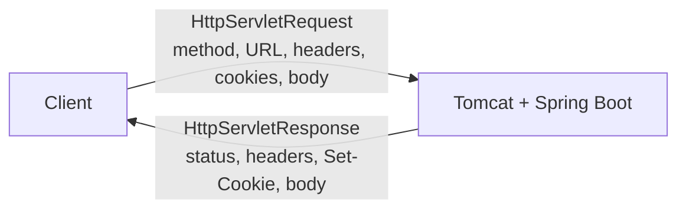
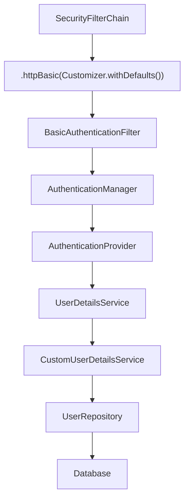

# Why Authentication Uses Headers (Basic Auth, Cookies, and Bearer/JWT Tokens) Instead of Body or URL Params

## 1. Background — What `HttpServletRequest` and `HttpServletResponse` Actually Are

In Spring Boot, every incoming HTTP request is handled by an embedded server (Tomcat by default).

For each request, the server provides Spring with two objects:

* `HttpServletRequest` — represents everything coming **into** the server.
* `HttpServletResponse` — represents everything going **out** of the server.

Together, they represent the complete HTTP request/response exchange.



`HttpServletRequest` contains:

* HTTP method (`GET`, `POST`, etc.)
* URL and query parameters
* request headers
* cookies
* request body

It is mainly used for **reading** information from the incoming request.

`HttpServletResponse` contains:

* HTTP status code (`200`, `404`, etc.)
* response headers
* `Set-Cookie`
* response body

It is mainly used for **writing** information into the outgoing response.

Spring provides higher-level tools that read and write these objects for you:

```java
@RequestBody
@RequestParam
@PathVariable
ResponseEntity
```

For example, `@RequestBody` reads data from the request body, while `ResponseEntity` helps build the response.

---

# 2. HTTP Basic Authentication — The Simplest Example

Before understanding sessions and Bearer tokens, it is useful to start with **HTTP Basic Authentication**.

With Basic Auth, the client sends the username and password in the `Authorization` header **on every request**.

For example:

```http
GET /api/v1/users HTTP/1.1
Host: localhost:8080
Authorization: Basic <Base64(email:password)>
```

Conceptually:

```text
email    = admin@example.com
password = password123
```

The credentials are encoded as:

```text
Base64("admin@example.com:password123")
```

Base64 is **not encryption**. Therefore, Basic Auth should always be used over **HTTPS**.

---

## 2.1 How Spring Security Enables Basic Auth

In Spring Boot, Basic Authentication can be enabled in the `SecurityFilterChain`:

```java
@Bean
public SecurityFilterChain securityFilterChain(
        HttpSecurity http) throws Exception {

  http
          .authorizeHttpRequests(auth -> auth
                  .requestMatchers("/api/v1/users/**")
                  .hasRole("ADMIN")
                  .anyRequest()
                  .authenticated()
          )
          .httpBasic(Customizer.withDefaults());

  return http.build();
}
```

# ⛔ Basic Auth + Session: Why Wrong Passwords Were Accepted

## Bug
With `IF_REQUIRED` session policy, after one successful Basic Auth login, Spring stores the `SecurityContext` in
the session. On later requests, `BasicAuthenticationFilter` skips re-checking the
password **if the username matches** the one already authenticated in session
— so a wrong password with the same (correct) email got through.

## Fix
```java
session.sessionCreationPolicy(SessionCreationPolicy.STATELESS)
```
No session stored/read → every request re-verified from scratch.

## Where the password check happens
`CustomUserDetailsService` only fetches the user — it doesn't compare passwords.
Spring auto-builds a `DaoAuthenticationProvider` from your `UserDetailsService` + `PasswordEncoder` beans,
and it's this provider that internally calls `passwordEncoder.matches(rawPassword, storedHash)`.

## Why the `PasswordEncoder` bean is needed
Without it, Spring defaults to `DelegatingPasswordEncoder`, which expects a `{bcrypt}` prefix on stored hashes.
A plain `BCryptPasswordEncoder` hash has no prefix → throws `No PasswordEncoder mapped for id "null"`.
Declaring `BCryptPasswordEncoder` explicitly avoids this.

## STATELESS vs IF_REQUIRED

| | IF_REQUIRED | STATELESS |
|---|---|---|
| Session | Created & reused | Never created/read |
| Use case | Web login w/ cookies | REST APIs (Basic/JWT) |
| Credentials | Checked once | Checked every request |

**Mismatch risk:** session-based auth + `STATELESS` → forces re-login every request.
Stateless auth (Basic/JWT) + `IF_REQUIRED` → password can be silently skipped on later requests (this bug).

The important line is:

```java
.httpBasic(Customizer.withDefaults());
```

This tells Spring Security to configure the **HTTP Basic Authentication mechanism**.

Spring Security then adds the necessary filters to the security filter chain, including `BasicAuthenticationFilter`.



---

## 2.2 `UserDetailsService`

Spring Security provides the `UserDetailsService` interface as a contract for loading users.

We can provide our own implementation:

```java
@Service
@RequiredArgsConstructor
public class CustomUserDetailsService implements UserDetailsService {

  private final UserRepository userRepository;

  @Override
  public UserDetails loadUserByUsername(String email) {

    return userRepository.findByEmail(email)
            .map(user -> User.withUsername(user.getEmail())
                    .password(user.getPassword())
                    .roles(user.getRole().name())
                    .build()
            )
            .orElseThrow(() ->
                    new UsernameNotFoundException("User not found")
            );
  }
}
```

Two things are important here.

### `implements UserDetailsService`

This tells Spring Security that the class follows the `UserDetailsService` contract.

Spring Security can therefore use it when it needs to load a user.

### `@Service`

This registers the class as a Spring bean.

The class name `CustomUserDetailsService` is not special. What matters is that the class:

```java
implements UserDetailsService
```

and is registered as a Spring bean.

**This same `UserDetailsService` is reused later for JWT** (section 5) — it is not tied to any one authentication mechanism.

---

## 2.3 Complete Basic Auth Flow

When the client sends:

```http
GET /api/v1/users
Authorization: Basic <Base64(email:password)>
```

the controller does **not** manually read the `Authorization` header.

Spring Security processes authentication first.

```mermaid
sequenceDiagram
  participant C as Client
  participant F as BasicAuthenticationFilter
  participant A as AuthenticationManager
  participant U as CustomUserDetailsService
  participant DB as Database
  participant Ctrl as UserController

  C->>F: GET /api/v1/users + Basic Auth
  F->>A: Authenticate credentials
  A->>U: loadUserByUsername(email)
  U->>DB: findByEmail(email)